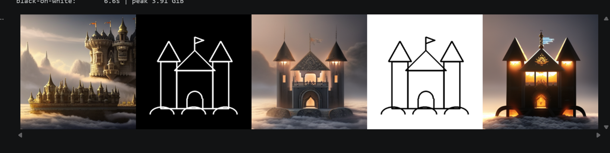
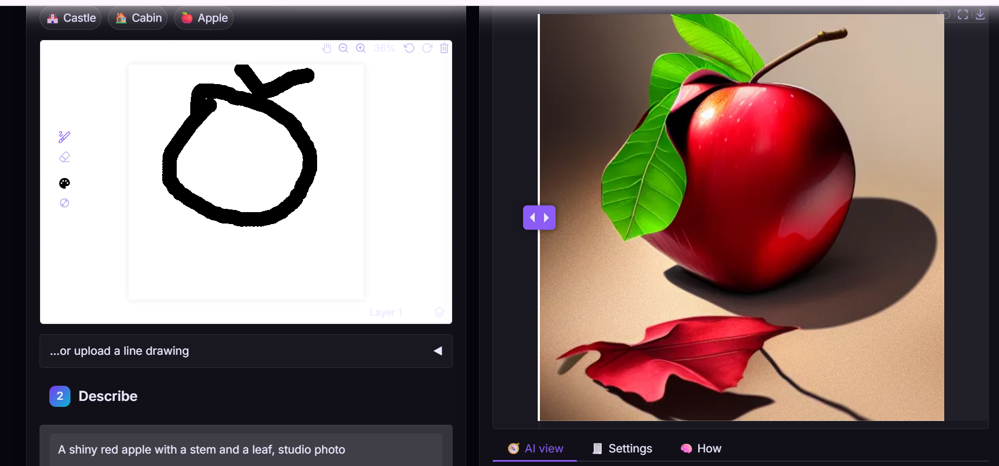

# ✦ DreamForge AI: Sketch to Image

Scribble a rough shape, describe a world, and watch it get forged.
DreamForge turns a hand-drawn sketch plus a text prompt into an image using
**Stable Diffusion 1.5 + ControlNet (Scribble)**, wrapped in a Gradio app.

[](https://colab.research.google.com/github/snehal-thombare/dreamforge-ai/blob/main/dreamfrog.ai.ipynb)





## How it works

```
Your sketch -> clean + invert to white-on-black -> ControlNet (spatial hints) --+
                                                                                v
Your prompt -> CLIP tokenizer + text encoder ----------------------------> U-Net denoises -> VAE decoder -> image
```

The sketch decides **where** shapes go. The prompt decides **what** they are.

## Features

- Draw on a canvas or upload a line drawing; starter sketches included
- 5 style presets, adjustable control strength, steps, guidance, seed
- Before/after slider (sketch vs result), history gallery, settings tab
- Input validation and friendly errors (empty prompt, blank sketch, GPU out of memory)
- Safety checker enabled; fixed seed gives identical output (max pixel difference 0 on rerun)
- fp16 on GPU: about 3.9 GiB peak VRAM, about 6 s per 25-step image on a Colab T4

## Evaluation

30 generations (3 sketches x 2 seeds x 4 control strengths, plus step tests), 0 errors.
Two simple metrics:

- **Sketch adherence gain**: how much more the output's edges follow the *right* sketch than the other sketches
- **CLIP cosine**: how well the image matches the prompt

| Control strength | Adherence gain | CLIP cosine |
|---|---|---|
| 0.0 | -0.032 | 0.332 |
| 0.5 | 0.305 | 0.324 |
| 1.0 | 0.336 | 0.341 |
| 1.5 | 0.410 | 0.316 |

**Findings**
- Going from 0.0 to 0.5 raises sketch adherence a lot (increased in 6/6 pairs).
- Going from 0.5 to 1.0 adds very little (+0.021 on average).
- At 1.5, prompt alignment (CLIP) drops in 6/6 pairs vs 1.0. **A good range is about 0.5 to 1.0.**
- Time scales roughly linearly with steps (10 steps: 2.6 s, 25: 6.3 s, 40: 9.7 s).

**Limitations (honest)**
- Only 3 test sketches and 2 seeds, so treat the numbers as indicative, not conclusive.
- Adherence uses Canny edges, a rough proxy. CLIP similarity is not a measure of beauty.
- SD 1.5 at 512x512; the sketch is guidance, not a guarantee.

## Run it

**Colab (easiest):** open the notebook, set Runtime -> T4 GPU, run all cells.

**Locally (NVIDIA GPU recommended):**
```bash
git clone https://github.com/<your-username>/dreamforge-ai
cd dreamforge-ai
pip install -r requirements.txt
python app.py
```
Open the local URL it prints. First run downloads about 5 GB of model weights.

## Project files

| File | What it is |
|---|---|
| `app.py` | the full app (model, preprocessing, generation, UI) |
| `DreamForge_AI.ipynb` | step-by-step notebook: setup, tests, evaluation |
| `requirements.txt` | app dependencies |
| `assets/` | screenshots, results grid, demo GIF |

## Credits and licenses

- [Stable Diffusion v1.5](https://huggingface.co/stable-diffusion-v1-5/stable-diffusion-v1-5): CreativeML OpenRAIL-M
- [ControlNet v1.1 Scribble](https://huggingface.co/lllyasviel/control_v11p_sd15_scribble): OpenRAIL
- Built with Hugging Face Diffusers, PyTorch, Gradio

Generated images are subject to the model licenses. Please use responsibly.

## Author

**Snehal Thombare**: [LinkedIn](https://www.linkedin.com/in/snehal-thombare-a0a58836a?utm_source=share_via&utm_content=profile&utm_medium=member_android) · [GitHub](https://github.com/snehal-thombare)
